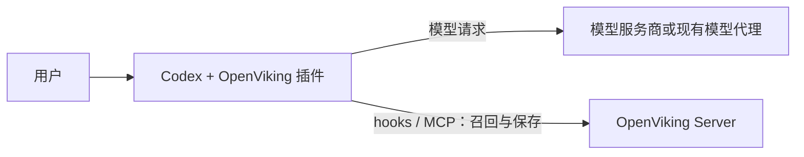
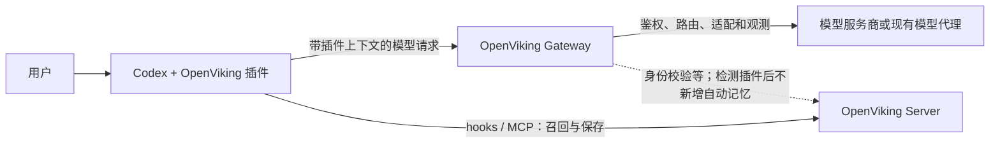

# OpenViking 网关与插件共存：机制、副作用、额外收益与选型

分析日期：2026-10-22。源码基线：`f34a54fd104e56ac23469d0c24df592fc01d2542`。主要场景：Codex 安装 OpenViking Memory 插件，同时把模型 Base URL 指向 OpenViking 模型网关。本文中的 gateway 指 `openviking_gateway/`，不指 VikingBot 的渠道网关。

## 1. 结论与适用条件

**同时使用网关和插件是有意支持的组合，但有额外成本。相比只使用插件，其主要收益来自模型访问管理和观测，并非记忆能力叠加。**

正常情况下，插件在模型请求里带入 OpenViking 上下文标记；网关识别后，为该网关会话记录停用状态，不再主动召回新记忆、捕获新对话、提供新的网关工具或触发新的网关压缩。插件继续通过自己的 hooks 和 MCP 完成记忆闭环。

然而，网关仍在模型请求的必经路径上。鉴权、上游选择、部分会话状态处理、供应商适配、响应解析与请求日志仍然存在。因此不能把这种组合描述为“毫无副作用”或“完全透明、逐字节直通”。

| 核心问题 | 判断 |
| --- | --- |
| 会不会正常情况下重复召回、重复保存？ | 检测到插件后的设计是避免重复；不能把它提升为所有异常和中途切换情形的绝对保证。 |
| 会不会提高插件的召回质量？ | 没有直接机制保证。正常共存时网关不再主动召回。 |
| 会不会补一套记忆备份？ | 不会。插件停用或失败时，不应假设网关在原会话自动接管。 |
| 会不会多一层延迟和故障依赖？ | 会；本次没有测量其大小。 |
| 能得到什么额外收益？ | 模型密钥托管、人员访问控制、上游与别名管理、请求与 usage 观测，以及无插件客户端的统一入口。 |
| 对个人是否必须？ | 不必须。如果只想用共享记忆且现有模型直连已经满足需求，只用插件更简单。 |
| 对部门是否有价值？ | 如果确实需要统一模型入口和凭据治理，可以与插件配合；记忆与模型两条治理链路仍要分别管理。 |

## 2. 先明确两种接入方案

### 2.1 只使用插件

插件决定如何从 OpenViking 取记忆、怎样把内容交给 Agent、什么时候捕获对话。模型流量不需要经过 OpenViking 模型网关。OpenViking 记忆服务出现故障，并不从架构上切断模型的直接访问路径；具体等待和排队行为由插件决定。

### 2.2 同时使用网关和插件

两条连接相互独立：修改模型 Base URL 不会自动修改插件的 OpenViking Server 地址、账号或 API Key。网关提供模型访问入口；插件继续连接其配置的记忆服务。

本会话此前检查到 Codex 的模型 Base URL 为 `http://127.0.0.1:1935/v1`，插件版本为 0.11.11。用户提供的网关日志持续显示“检测到 OpenViking 插件”，这与上述组合相符。该观测不是插件写入成功的端到端证明，也不等于已核实正在运行的网关与本仓库 HEAD 完全一致。

## 3. 共存机制：谁负责记忆

### 3.1 网关如何识别插件

`openviking_gateway/protocols.py:259` 的 `plugin_present` 检查两类信号：

1. 请求头存在 `x-openviking-plugin`。
2. 客户端提交的上下文出现规则认可的插件标签，例如 `<openviking-context>`。

`client_texts` 只从 system/instructions 及 user、system、developer 消息提取文本，不把 assistant 回复或工具输出直接作为插件安装证据，见 `protocols.py:243`。网关生成的 `source="gateway-..."` 开场标记会被排除，避免把自身注入误认为插件。

这是一种协作信号检测，**不是插件健康检查，也不是密码学意义上的插件身份认证**。它不能证明插件当前的召回、捕获或提交都成功了。

### 3.2 识别结果在会话内持续有效

`openviking_gateway/kernel.py:229` 先读取已有 DISABLED 状态；首次发现插件后写入原因 `plugin_present`。后续同一网关会话继续停用主动记忆，即便某个请求不再携带插件标记。

这避免了插件上下文被压缩、某轮请求格式变化后，网关突然重新接管。对应代价是：**停用插件后，仅在原会话里继续提问，不足以切换到网关记忆。应使用一个新的、无插件的会话。**

测试 `tests/gateway/test_kernel.py:444` 明确检查：第二轮出现插件，第三轮删除标记，网关仍保持 disabled，召回次数不增加。

### 3.3 哪些能力让给插件

| 能力 | 正常共存行为 | 源码证据 |
| --- | --- | --- |
| 新的自动记忆召回 | 网关不执行，插件负责 | `kernel.py:304` |
| 网关开场画像与目录 | 不再走网关的召回开场分支 | `kernel.py:304`、`:548` |
| 用户消息触发的保存确认 | 网关不执行 | `kernel.py:287` |
| 模型回复进入新的捕获队列 | disabled 时提前返回 | `kernel.py:714` |
| 队列中尚未投递的内容 | worker 看到 disabled 后清理 pending/archive，不继续投递 | `capture.py:363` |
| 新的网关 OpenViking 工具 | 正常从会话开始检测到插件时不提供 | `kernel.py:234`、`:369` |
| 新的自动上下文压缩 | disabled 时不触发 | `kernel.py:295` |
| 新的窗口提醒 | 不执行 | `kernel.py:304` |

因此，“插件召回一次，网关再召回一次，提高覆盖面”不是正常共存模式。

### 3.4 只有 MCP 工具时，行为不同

客户端只注册 OpenViking MCP 工具，没有插件自动注入信号时，网关不把它视为插件接管。网关仍可自动召回和保存，但避免提供重复的 OpenViking 工具。

证据：`protocols.py:280`、`kernel.py:384`。不要把“安装完整插件”和“只接 MCP”混为同一种组合。

## 4. 与只用插件相比，有哪些副作用

### 4.1 每次模型调用都多经过网关

网关先接收请求体、解析 JSON、选择上游，再进行上下文准备和转发，见 `proxy.py:173`。插件检测位于 `kernel.prepare` 内部；在检测之前，会话标识与状态读取等工作已发生，见 `kernel.py:190`。检测到插件后，也仍然存在上下文大小估算和部分状态记账，见 `kernel.py:289`、`:680`。

新增成本包括本地或远程网络转发、请求解析、历史链计算、SQLite 访问、身份校验及流式响应处理。大历史和大量工具步骤会放大处理量。localhost 部署避免了远程网络距离，但没有消除处理成本。

**本次不能给出“增加几毫秒”或“几乎零开销”的数值结论。** 需要同模型、同参数、同请求、同缓存条件的对照测量。

### 4.2 增加模型访问的故障点

只使用插件时，模型请求不依赖该网关。两者共存时，网关进程、网关凭据、上游配置和存储都进入模型调用链路。

| 故障 | 只用插件 | 插件 + 网关 |
| --- | --- | --- |
| 插件召回失败 | 记忆能力受损，模型路径仍可用 | 同样受损；网关识别到插件不代表会接管 |
| 网关进程停止 | 不使用它，不直接受影响 | 模型调用无法经该入口完成 |
| 网关 key 被撤销或失效 | 无该依赖 | 可能在访问模型前返回 401 |
| 网关不允许目标模型 | 无该网关限制 | 返回 403 |
| 上游配置无匹配项 | 由原模型接入处理 | 网关返回 404 |
| 记忆服务暂不可用 | 插件按自身策略降级 | 网关也可能跳过身份复核继续转发；不能等同于所有故障都能降级 |

证据：`app.py:175` 的鉴权与降级处理，`proxy.py:227` 的模型限制、`:251` 的无匹配上游处理、`:202` 的上游网络错误处理。

特别是 OpenViking 身份凭据被明确判定无效，与“服务暂不可达”不同。前者可能撤销网关 key 并拒绝模型访问；后者存在继续转发的路径，见 `app.py:182`。

### 4.3 不是插件故障自动兜底

例如，会话开始时插件已经注入记忆目录，网关记录了 disabled；之后插件的 API Key 失效，自动捕获失败。此时网关仍会避让，不能因此获得第二份可靠记忆。

网关识别的是请求标记和已有停用状态，不会逐轮检查插件是否真正完成保存，也没有通过该机制自动选择“哪个记忆组件更健康”。

因此需要分别验证：模型链路可用、插件召回可用、插件写入与长期提取可用。三者不是同一个健康指标。

### 4.4 网关策略不能直接约束插件 MCP

网关 key 的模型白名单和允许上游，对经过网关的模型请求生效。但插件的 MCP 请求直接使用其配置的 OpenViking 凭据。

因此，网关 profile 中关闭某个写工具，不等于禁止插件通过其 MCP 写入；网关调整召回范围或 token 预算，也不会自动改写插件配置。网关的 `disabled_tools` 用来筛选自己提供的工具，见 `tool_catalog.py:87`。

部门推广时，模型访问治理与记忆数据治理应分别落到相应凭据、权限和插件配置上。仅部署一个模型网关，不能让客户端记忆行为天然统一。

### 4.5 “只做转发”仍可能修改请求

正常共存时，网关不会再主动添加一套记忆，但下列行为仍可能生效：

- 过滤、替换请求认证头，使用网关配置的服务商 key，见 `proxy.py:53`、`:113`。
- 按模型别名替换 `model`，见 `proxy.py:307`。
- 按供应商设置处理参数；Ark/BytePlus 在特定协议下会写入 `prompt_cache_key`，见 `vendors.py:34`。该分支没有以插件 disabled 为跳过条件。
- 根据会话已存状态处理历史，见下一节。

所以，比较答案质量、缓存或费用时，需要确认最终上游和参数一致。客户端显示相同模型名，不足以证明别名映射后调用了同一个端点。

### 4.6 会话中途切换，历史不会被彻底清空

若前几轮只有网关工作，后来才启用插件，网关会停止新的记忆工作，但已有注入可能继续重放，以保持历史一致。

`tests/gateway/test_kernel.py:444` 验证了插件出现后，旧的网关注入前缀仍保留。`tests/gateway/test_capture_lifecycle.py:63` 验证了已有压缩替换在插件停用标记出现后仍存续。

这意味着“网关让路”不代表旧注入、旧摘要或已落库内容被撤销。已经发出的保存请求也不能因后来检测到插件而追溯撤回。后台 worker 清理尚未投递内容，不是跨组件的分布式事务。

想做干净的“只用插件 / 插件加网关 / 只用网关”比较，应分别新建会话，避免中途混用影响结果。

### 4.7 插件识别存在边界

标准插件输出标准标记时，这是明确设计的兼容路径。但自定义客户端若删除标签、修改标签且未同步规则，也不发送显式请求头，网关可能暂时无法识别插件，出现两边同时处理记忆的风险。

反过来，用户消息中的原样插件标签也可能符合检测条件。代码只排除了网关自身的 source，以及 assistant/工具输出等来源，没有把用户文本中的标签与真正插件注入做来源认证。

工程含义：对自研接入，应稳定传递协作标记或显式头；不要把当前检测器当作插件安装状态的绝对事实。这里描述的是源码可推导的边界，不代表当前安装已经发生误判。

### 4.8 协议与运行环境增加约束

该网关为 Anthropic Messages、Chat Completions、Responses 选择同协议上游，见 `proxy.py:40`、`:139`；这不是任意协议之间的转换器。WebSocket 请求会收到 426，要求 HTTP 回退，见 `app.py:228`、`proxy.py:174`。

网关的共享 HTTP 会话设置 `trust_env=False`，见 `app.py:63`。如果直连客户端依赖环境变量配置代理，不能假设网关自动继承同一网络出口。

网关先读取整个请求体，并检查 `max_body_bytes`，见 `proxy.py:176`。超大 Coding 历史、附件或特殊客户端能力，需要单独核对。当前普通 HTTP 请求成功，不等于所有原生 API 特性都已兼容。

### 4.9 多一处处理数据与保存状态

网关必须在运行时读取模型请求和回复，才能检测插件、计算 usage、维护会话和转发流。请求日志只记录元数据，不能解释成“网关完全看不到内容”，也不能解释成“网关全部内部状态都只有元数据”。

`proxy.py:477` 在流中解析响应；`kernel.py:680` 即使最终因 disabled 跳过捕获，也先做部分观测记账。管理库存放上游凭据和关联的 OpenViking 凭据；`management.py:431`、`storage.py:461` 展示了签发与认证方式。

此外，`app.py:44` 明确说明没有 encryptor 时按明文存值；`config.py:155` 表明独立网关加密配置是可选的。因此应按实际部署核实加密、文件权限、备份和保留时间，不能仅凭 UI 的“只记录元数据”判断所有数据的存储形式。

这不表示正常插件共存会必然多保存一份完整对话；它说明新增了一个处理模型内容、维护凭据和状态的服务边界。

## 5. 相比只用插件，额外收益在哪里

### 5.1 模型服务商凭据集中托管

在 managed 上游模式下，客户端使用网关 key，网关保管服务商 API Key，再转发到上游。管理员可轮换上游密钥，避免每位开发者都配置一份服务商原始密钥。

证据：`proxy.py:94`、`:113`，`management.py:431`。注意 upstream 也支持 passthrough，该模式下 key 来自客户端 `x-openviking-upstream-key`，不能一概宣称所有网关配置都隐藏服务商 key。

额外价值属于模型访问管理；插件仍需要访问 OpenViking 的凭据，不能因网关 key 已配置就删除插件凭据。

### 5.2 按 key 控制模型和上游

网关 key 绑定允许的上游集合和模型集合。`proxy.py:227` 检查模型，`:235` 筛选允许上游，`:242` 按 priority 和 ID 排序候选项。

这对部门场景有实际意义：不同人员可使用不同上游或模型集合，撤销一个网关 key 可以阻断其通过这个入口的模型访问。

边界是：白名单不等于预算配额或自动成本上限；本次核查的请求路径也没有展示“上游失败后循环重试其他候选”的实现。**不能把优先级路由宣传成已实现自动故障切换或负载均衡。**

### 5.3 集中管理上游和模型别名

可以在入口处维护上游地址、认证头、模型列表和别名，让不同客户端使用统一入口。正常插件共存不影响这部分配置价值。

不过既有会话会保存首次选定的上游与策略快照，见 `kernel.py:323`、`:214`。修改管理配置后，不应假设所有正在进行的会话立刻完整切换到新配置。删除或禁用上游还可能使既有会话不能继续按原路径访问；迁移需要单独验证。

### 5.4 观察模型调用，而不只观察记忆调用

网关可以记录模型请求类型、模型名、HTTP 状态、上游 ID、输入输出 token、缓存 token，以及已采集的处理状态。见 `proxy.py:204`、`:347`、`:391`。

插件专注记忆，对模型 HTTP 链路的统一观测通常有限。网关因此有助于回答：一次用户提问触发了多少次模型调用、工具循环使输入增长多少、上游是否报错、上游报告了多少缓存命中。

但该收益不能夸大：

- Token 和缓存值取决于上游是否返回以及适配器能否解析；它们不是独立的计费审计。
- 缓存命中率高不代表网关主动提升了命中率，也不等于端到端响应一定更快。
- `proxy.py:192` 在准备流程结束后才启动计时，`:354` 计算 `duration_ms`。该值不能完整反映用户发送请求到处理结束的全部耗时，尤其不含之前的鉴权和准备时间。
- 该页面不是插件记忆写入成功率仪表盘。

### 5.5 为不同客户端提供统一入口

可以让支持插件的 Coding Agent 保留插件，让无插件的聊天客户端、脚本或业务应用使用网关自己的记忆能力。这样团队共享模型访问入口和 OpenViking 基础设施，同时按客户端能力选择记忆接入方式。

这是一种团队架构收益，不代表同一个 Codex 会话同时得到两套记忆功能。

## 6. 哪些收益不能算到当前组合上

| 常见期待 | 正常插件共存时的实际边界 |
| --- | --- |
| 两层召回提高记忆命中 | 网关的新召回被停用。 |
| 两层捕获避免记忆丢失 | 网关的新捕获被停用，不构成插件写入备份。 |
| 网关自动修复插件 401 | 没有这样的接管机制；模型请求本身还可能受网关凭据检查影响。 |
| 网关补强 Codex 的上下文压缩 | 检测插件后不触发新的网关自动压缩。 |
| 打开 agent_windows 就能给当前插件会话增加窗口管理 | 正常共存时网关不成为工具 owner；不能据配置开关推断能力实际生效。 |
| 网关页面改召回策略，插件随之更新 | 两者配置链路独立。 |
| 网关缓存 99%，所以接入省了 99% 成本 | 命中量来自上游 usage，费用还取决于真实定价与对照基线。 |
| 只有插件无法跨工具共享记忆 | 插件本身就可以接同一 OpenViking 账号与服务，网关不是跨工具共享的前提。 |

窗口能力的默认配置见 `models.py:63`，工具 owner 与新压缩的门禁见 `kernel.py:234`、`:295`。

## 7. 如何理解你看到的请求日志

### 7.1 “检测到 OpenViking 插件”是避让状态

`kernel.py:464` 把插件停用状态写进 `metrics.degradation="plugin_present"`。UI 的问题筛选使用 `Boolean(record.degradation)`，见 `web-studio/src/routes/gateway/-components/requests-page.tsx:72`。

所以，一条 HTTP 200 的请求可能同时列入“异常”：它命中了广义的降级/问题字段，而非模型调用失败。截图中的“异常 78”不能直接当作 78 次故障，也不能用它除以总请求数计算真实错误率。应拆开统计 HTTP 错误、记忆服务失败、主动插件避让等原因。

### 7.2 “保存正常”不是插件写入成功证明

网关的 capture 状态从其自身 capture 文档与策略推导，见 `capture.py:214`。没有 error 时可显示 active，即使该模型请求因插件 disabled 并未进入网关新捕获链路。

因此，“HTTP 200 + 保存正常 + 检测到插件”只支持模型请求成功且网关记录了避让等结论。要证明插件保存成功，需要看插件自己的捕获、提交结果，以及 OpenViking 中对应会话的写入状态。

### 7.3 “工具步骤”记录的是后续模型调用

UI 将 `continuation` 映射到工具步骤分类，见 `requests-page.tsx:64`。分类器在最新用户消息后已有后续交互时返回 continuation，见 `protocols.py:409`。

一次提问可能触发多次工具执行及模型继续请求。网关记录的是这些模型请求，既不表示工具都由网关执行，也不保证每一条 continuation 都严格对应一次独立工具命令。

## 8. 关于“会话开始时不能注入系统上下文”

这个判断需要拆成两件事。

**网关能在首次符合条件的模型请求发出前补充开场上下文。** `profile.py:211` 的 `build_profile` 按策略读取画像，并在 read 工具可用等条件下构建记忆与技能目录；`kernel.py:548` 构造 `gateway-session-start` 块，`:585` 通过协议适配器把它附到当前用户消息。

但它不是客户端原生 SessionStart，也不等于增加了 system/developer 角色的高优先级指令。它不会仅凭模型代理层就在客户端本地运行 hook、读取任意工作区配置或向客户端原生技能系统注册技能。

插件则有 Agent 原生事件入口。Codex 的 hooks 包括 SessionStart、UserPromptSubmit、Stop、SessionEnd、PreCompact，见 `examples/codex-memory-plugin/hooks/hooks.json:3`。共享插件还有基于 Git 与工作区配置计算 peer 的逻辑，见 `examples/memory-plugin-shared/lib/workspace-peer.mjs:32`。

因此，对“按仓库自动分发部门规范与技能”这一目标，插件具有更直接的工作区与生命周期集成优势。网关可以给模型提供远程上下文，但不能据此视为完整替代该集成。

## 9. 当前代码表达的接入取向与建议

### 9.1 可以确认的项目设计取向

当前源码专门实现插件检测、会话持续避让、MCP 工具冲突处理，并提供对应测试。这表明“共存但分工”是有意设计的接入方式，不是偶然能够跑通。

这里能核实的是本仓库基线的项目行为。仓库 origin 是个人 fork，本次没有在线比对上游最新发布版本，也没有据此承诺所有已发布版本具有相同实现。所谓“官方建议”，应限定为随当前代码体现的接入取向，不能扩展成“官方保证双开永远没有副作用”。

### 9.2 对你个人当前使用方式的建议

如果你保留网关，是为了请求日志、模型访问管理、上游与 key 配置，那么可以继续双用。清晰地把它看作“插件负责记忆，网关负责模型访问与观测”。

如果你只是想增强记忆，模型直连本来已经稳定且不缺观测，那么只使用插件更简单。正常共存没有带来第二套召回、保存或压缩能力。

如果你是想评估网关自身的召回、开场上下文和长会话能力，应停用插件并新建会话。不要从当前持续出现 `plugin_present` 的日志推断这些网关能力好不好用。

### 9.3 对部门落地的建议

把决策拆成两个独立问题：

1. **上下文基础设施**：OpenViking Server + 各工具插件，承接技能分发、项目标记、会话捕获与共享记忆。
2. **模型访问基础设施**：是否额外部署 OpenViking Gateway，承接服务商密钥托管、模型访问限制和统一请求日志。

如果部门已有稳定的模型网关、统一密钥管理和观测体系，应比较新增 OpenViking Gateway 的具体增益，避免只因用了 OpenViking 记忆就重复增加一层模型代理。可以先让插件直接复用既有模型访问路径。

如果部门缺少模型入口，或需要让无插件客户端获得 OpenViking 记忆，网关价值更明显；但仍需独立核实部署可靠性、凭据生命周期和客户端协议兼容性。本次没有进行百人 SLA 验证。

## 10. 如何做公平验证

以下为后续验证方案，本次未执行付费模型调用、未停止服务、未修改现有插件或网关配置。

### 10.1 对照条件

建立三个独立新会话：A 为只用插件，B 为插件加网关，C 为只用网关。A/B 用于回答本文的增量成本与收益；C 用来单独观察网关记忆能力，不能用来冒充 A/B 比较。

固定最终上游端点、实际模型、推理参数、工具清单、输入内容、历史长度和 OpenViking 身份。核对别名映射与供应商参数，区分冷缓存和热缓存。先用本地合成上游隔离代理开销；真实模型验证应遵循预算约束。

### 10.2 应观察的指标

| 目标 | 观测方法 |
| --- | --- |
| 网关额外延迟 | 客户端记录发送、首字节/首 token、结束时间；与直连对照，不仅看网关 duration_ms。 |
| 是否重复召回 | 核对插件召回记录与网关原因；B 正常应显示 plugin_present，不出现新的网关召回。 |
| 是否重复保存 | 对应客户端会话、插件会话和网关会话，检查新增写入的来源；不能只看 UI 保存状态。 |
| 插件写入是否成功 | 检查插件提交与服务端会话状态；随后检索只能作为补充，提取本身可能异步。 |
| 模型访问治理 | 验证允许模型与禁止模型的访问结果，确认 key 与上游授权对应。 |
| 故障影响 | 在隔离测试环境模拟网关停止、无效 key、记忆服务不可达，不在当前工作会话里直接停服务。 |
| 历史兼容 | 观察工具循环、客户端压缩、长历史、流式输出与 HTTP 回退。 |

低开销小样本可先证明功能路径；要得出稳定的延迟分位数、吞吐或可靠性结论，仍需独立设计负载与样本，不能由一两次请求推断。

## 11. 补充：仅网关时工具如何进入模型请求

工具定义通过模型 API 的结构化 `tools` 字段注入，不是安装到客户端的 MCP 注册表，也不是只把工具说明写进普通提示词。

1. `openviking_gateway/client.py:164` 调用 Server `/mcp` 的 `tools/list`，获取工具名、description、inputSchema。传输代码位于 `:184`。
2. `openviking_gateway/tool_catalog.py:87` 按 disabled_tools 过滤，给普通 MCP 工具加 `openviking_` 前缀，把 inputSchema 转为模型 function 的 parameters；可另加网关原生工具。
3. `openviking_gateway/kernel.py:376` 加载并保存会话工具决定；`:427` 通过协议适配器加入请求。公共适配器 `tool_protocols/common.py:274` 把原 tools 与新增 tools 合并；Responses 使用 `tool_protocols/responses.py:64` 的扁平 function 格式。
4. 上游模型输出工具调用后，`tool_loop.py:241` 的 HiddenToolLoop 分离网关与客户端工具调用。网关负责的调用在代理内部执行；属于客户端的调用仍发给客户端处理。
5. `tool_executor.py:222` 移除前缀，`:275` 使用绑定的 OpenViking key 发 `tools/call`。网关将调用结果加入后续模型输入，`tool_loop.py:274` 再请求上游；需要时循环多轮，直到结束或把控制交给客户端。

因此不支持安装 MCP 的聊天客户端也可以从网关工具受益，前提是模型与请求协议符合工具注入条件。用户可看到工具提示，但客户端无需承担这些网关工具的执行循环。默认写工具被禁用，权限不等同于客户端本地确认；网关也不能直接读客户端本地文件。

工具定义会占输入 token，内部继续调用会产生模型调用成本。自动 recall 与模型主动工具调用是两条不同路径。当前插件会话触发避让时，不应把上述工具注入当作已实际启用。

Graphify `explain HiddenToolLoop --budget 400` 返回无匹配；本节基于当前源码，无新建索引或真实模型调用。

## 12. 证据范围与本次验证状态

- 本文结论来自当前 Python 网关、Codex hooks、共享插件 peer 逻辑、相关测试和前端分类源码；路径与行号均为上述源码基线的定位。
- 已阅读既有共存与并发笔记，新增本文作为增量分析；既有笔记不作为技术事实的最终证据。
- Graphify 执行 `graphify explain plugin_present --budget 700` 返回 `No node matching 'plugin_present' found.`，未提供该网关机制的图谱证据。本次没有重建索引；CodeGraph 在此前已确认索引不存在后未继续调用。
- 检查到本机 OpenViking venv 缺少 pytest，未运行所引用的网关测试。本文引用的是测试代码表达的预期行为，不能当作本次测试通过报告。
- 没有执行模型性能对照、计费核验、故障注入或插件写入端到端验证。对这些效果保留实测边界。
- 交付内容是本地技术分析文档，没有自动提交、推送或改动运行配置。
