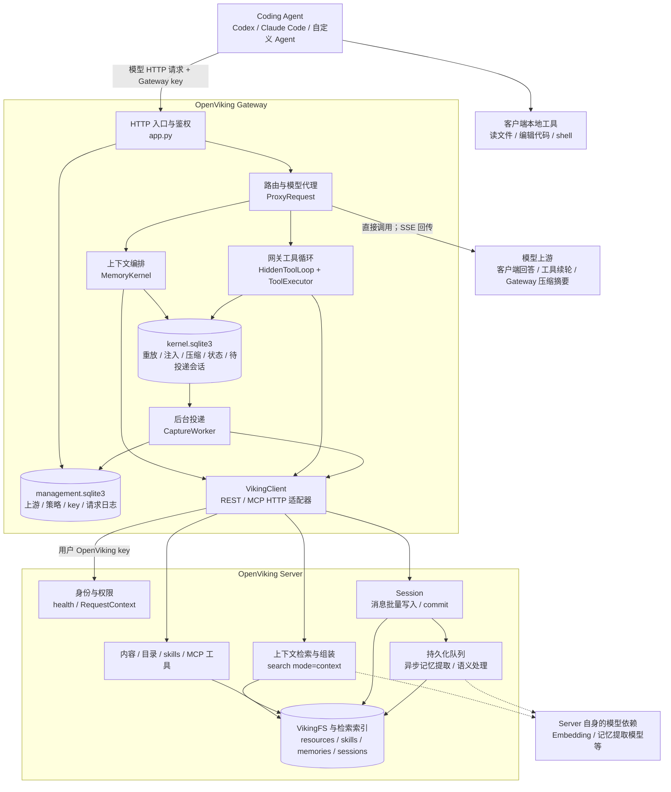
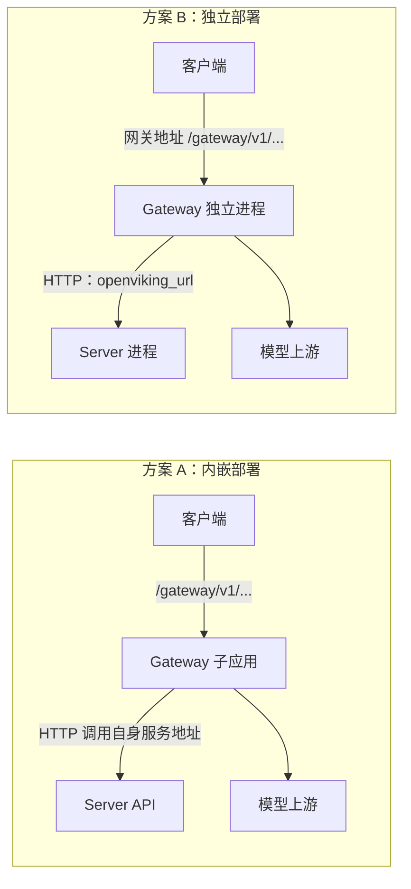
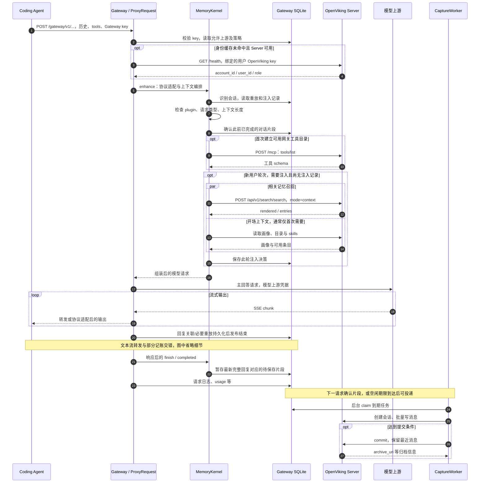
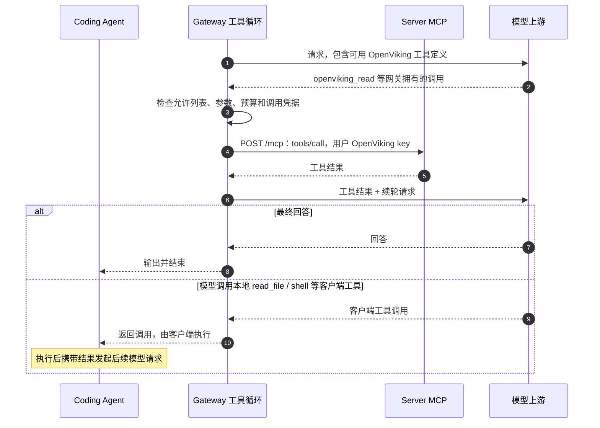
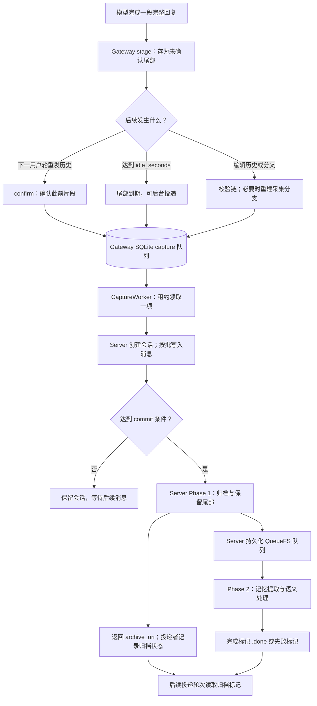
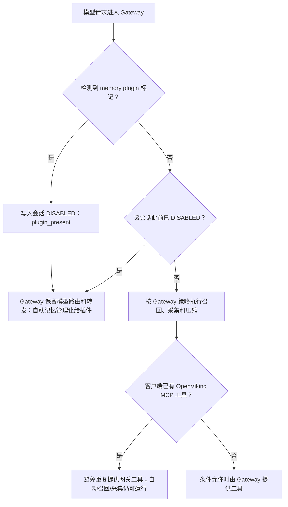
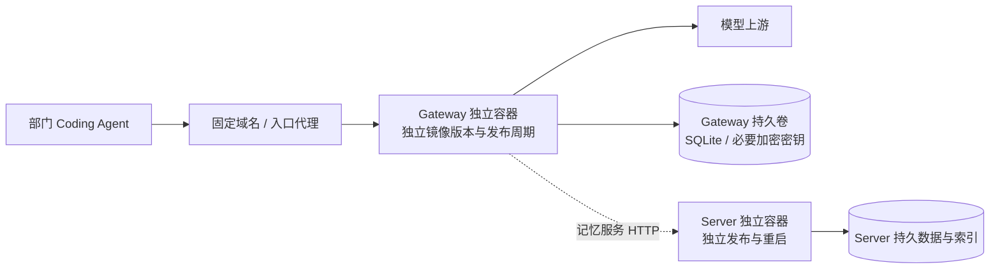

# OpenViking Gateway 与 Server：依赖关系和完整请求生命周期

> 调研日期：2026-10-22。源码基线：`f34a54fd1`，结论以本次工作区源码为准。
> 本文讨论 `openviking_gateway/` 模型网关。图中的“客户端”是 Codex、Claude Code 等 Coding Agent；“模型上游”是配置给网关的模型服务。

## 1. 先明确三个角色

**Gateway 接管模型 HTTP 请求，Server 提供上下文数据库能力，模型上游生成回答。**

启用 Gateway 后，客户端把模型请求发给 Gateway。Gateway 可以在调用模型之前检索记忆、组装上下文，在模型生成过程中代执行 OpenViking 工具，在响应之后安排会话保存。实际的检索、文件读取、会话存储和长期记忆提取，仍由 Server 承担。

| 角色 | 主要职责 | 在哪执行 |
|---|---|---|
| Coding Agent | 收集用户消息、维护客户端历史、执行本地读文件/改代码/shell 工具 | 开发者机器 |
| Gateway | 校验网关 key、选择模型上游、管理上下文、代理工具调用、转发回答、安排保存 | 独立进程，或 Server 内嵌子应用 |
| Server | 身份和权限、资源/技能/记忆检索、内容读写、会话归档、记忆提取 | OpenViking 服务 |
| 模型上游 | 根据 Gateway 发来的最终上下文生成回答、工具调用或压缩摘要 | 模型供应商或自建模型服务 |

源码依据：请求入口 `openviking_gateway/app.py:291`；转发 `openviking_gateway/proxy.py:173`；Server HTTP 适配器 `openviking_gateway/client.py:21`；Server 检索入口 `openviking/server/routers/search.py:482`；会话提交入口 `openviking/server/routers/sessions.py:667`。

## 2. 总体依赖关系图



图中有两条重要的外部调用方向：

1. **Gateway → 模型上游**：发送主回答请求、工具续轮请求和上下文压缩请求。
2. **Gateway → Server**：获取用户身份、召回上下文、读取内容、调用 MCP、保存会话和提交归档。

Server 并非主回答请求必须经过的模型中转站。另一方面，Server 为检索、提取等任务调用的模型属于服务端自身配置；不能假定它与 Gateway 的主回答模型是同一个配置、同一条调用链。

源码依据：`openviking_gateway/proxy.py:194`、`:313`、`:415`；`openviking_gateway/client.py:29`、`:88`、`:109`、`:184`。两套 SQLite 在 `openviking_gateway/app.py:55` 创建。Server 的异步提取入口见 `openviking/session/session.py:2152`。

## 3. 内嵌与独立部署：同一套逻辑，两种宿主



### 3.1 内嵌模式

Server 在 `gateway.enabled` 为真时创建 Gateway，并把它挂载到 `/gateway`。因此访问的是 Server 地址下的 `/gateway/v1/messages`、`/gateway/v1/chat/completions` 或 `/gateway/v1/responses`。启动时宿主显式管理 Gateway lifespan，共享服务端加密配置，还提供读取账户有效 VLM 配置的回调。

**同进程不等于所有调用都直接调用 Python 对象。**内嵌构造仍为 Gateway 设置 Server URL，`VikingClient` 的检索、会话和 MCP 调用依然使用 HTTP。账户 VLM 配置回调是额外的进程内接点，不应推广成所有数据调用都绕过 HTTP。

源码依据：`openviking/server/gateway_host.py:23`、`:32`、`:40`、`:50`；`openviking/server/app.py:403`、`:835`；挂载常量 `openviking_gateway/config.py:20`。

### 3.2 独立模式

独立进程从配置读取 `openviking_url`，创建同一个 Gateway 应用，再挂载到 `/gateway`。独立宿主还提供健康检查、Studio 和有限管理转发。配置默认监听 `127.0.0.1:1935`，这是独立网关默认值，并不代表 Server 的端口。

独立模式支持 `workers`，默认 1。内嵌模式没有独立的 Gateway workers 配置；不能给内嵌 Gateway 单独配置这项参数。

源码依据：`openviking_gateway/standalone.py:74`、`:115`、`:156`；`openviking_gateway/config.py:136`、`:150`；`openviking_gateway/cli.py:153`。

## 4. 请求前准备：三种凭据分别用于哪里

| 凭据 | 谁持有/提交 | 用途 |
|---|---|---|
| Gateway key，形如 `ovgw_...` | Coding Agent 发给 Gateway | 查找账户、用户、策略，以及允许使用的上游和模型 |
| 用户 OpenViking API key | 与 Gateway key 绑定，Gateway 调用 Server 时使用 | Server 校验身份与数据访问权限 |
| 模型供应商 API key | 由上游配置保存，或 passthrough 模式由请求提供 | Gateway 调用模型供应商 |

Gateway 签发 key 时，先用 OpenViking key 查询身份，检查账户/用户匹配，以及策略和上游是否存在，再生成随机网关 key。管理库按网关 key 摘要存储绑定信息。模型请求进入网关后，使用该绑定访问 Server。

模型转发会过滤客户端认证头，再按模型上游要求构造认证头。因此不能把这三个 key 当成同一个密码在各服务之间原样透传。

源码依据：`openviking_gateway/management.py:385`、`:421`、`:431`；`openviking_gateway/storage.py:461`；`openviking_gateway/proxy.py:55`、`:101`、`:125`；`openviking_gateway/client.py:35`。

## 5. 一次普通用户请求的完整时序

下面画的是“Gateway 负责记忆、未检测到 memory plugin、无需压缩、模型没有调用工具”的路径。图中有条件步骤和缓存命中，并非每次请求都真的发出全部 HTTP 调用。



源码依据：`openviking_gateway/app.py:173`、`:291`；`openviking_gateway/proxy.py:173`、`:267`、`:338`、`:347`、`:472`；`openviking_gateway/kernel.py:177`、`:287`、`:304`、`:565`、`:680`；`openviking_gateway/capture.py:132`、`:230`、`:310`、`:358`。

### 5.1 入口鉴权和选路

Gateway 先校验本地 key，再按需向 Server 确认其绑定用户的身份。身份成功结果缓存 30 秒，不能把这一步描述成每个模型请求都必须实时查询 Server。

代理层检查 key 允许使用的模型和上游，匹配协议与模型，按优先级选择候选。会话根记录保存上游和策略，后续请求会参考该记录保持会话行为稳定。模型别名、供应商专用字段在发送前适配。

源码依据：`openviking_gateway/client.py:25`、`:48`；`openviking_gateway/app.py:173`；`openviking_gateway/proxy.py:216`、`:235`、`:307`；`openviking_gateway/kernel.py:323`。

### 5.2 会话识别不是只看最后一条消息

Gateway 按 `account + user_id + protocol` 计算 scope，再优先读取会话标识。缺少明确会话标识时，通过历史回复归属识别续接关系；无法唯一确定时创建匿名会话。它还为历史生成链式锚点，用来定位已经注入的上下文、隐藏工具轮次及压缩切点。

这样做是因为客户端不断重发历史，但 Gateway 可能额外插入过工具结果、召回或摘要。Gateway 必须能把“客户端看见的历史”恢复成“模型后续仍需看见的历史”。这不是模型答案缓存。

源码依据：`openviking_gateway/kernel.py:144`、`:197`、`:284`；隐藏工具转录的保存见 `openviking_gateway/tool_loop.py:194`。

### 5.3 Server 检索，Gateway 决定如何注入

Gateway 从当前用户消息提取查询，按策略决定剩余 token 预算、context_types、分数门槛和排除 URI。它调用 Server 的 `search(mode=context)`，明确关闭 query expansion 和 rewrite。

Server 路由将请求交给 `assemble_context`，返回已经适合注入的 `rendered` 和命中 `entries`。Gateway 再加来源说明、开场信息与窗口提示，把上下文附到目标用户消息中，同时保存本轮注入决策。重试同一历史锚点时可以重放决策，避免重复召回和反复追加相同内容。

这体现了职责分工：**Server 负责根据权限检索并组装知识，Gateway 负责决定何时检索、预算多少，以及放进哪一次模型请求。**

源码依据：`openviking_gateway/client.py:88`；`openviking/server/routers/search.py:433`、`:467`、`:498`；`openviking_gateway/kernel.py:467`、`:577`、`:585`。

### 5.4 首次开场上下文与技能目录

Gateway 可读取用户画像、preferences/entities 目录及 skills 目录，并在预算内生成开场块。技能目录需要可用的 `openviking_read` 工具等条件支持；它不是每轮把所有技能正文塞入模型。

模型看到目录后，可以按需读取技能正文。这里注入的是模型请求中的文本，不等于在开发者机器安装技能，也不等于执行客户端原生 SessionStart hook。

源码依据：`openviking_gateway/profile.py:211`、`:241`、`:255`、`:261`；`openviking_gateway/kernel.py:548`、`:585`。

## 6. 模型调用 OpenViking 工具时，谁来执行？

Gateway 除了检索前置注入，还可以成为 OpenViking 工具提供方。它从 Server 的 MCP 工具目录获取 schema，按策略过滤，再转换成当前模型协议支持的工具定义。

**关键机制：Gateway 修改发给模型的 HTTP 请求，把工具定义追加到结构化 `tools` 字段；模型提出调用后，由 Gateway 执行，再把结果发回模型继续生成。**这条路径不要求客户端安装 OpenViking MCP，也不要求客户端自己实现这些 OpenViking 工具的执行循环。

以下以“仅使用 Gateway、未安装 memory plugin、策略和上游允许工具注入”为前提。当前会话如果检测到插件，网关会按第 10 节让路，不应据此认为下列工具已在当前请求实际启用。



一次客户端 HTTP 请求因此可能包含多次模型上游调用。Gateway 自己执行拥有的工具，但客户端本地工具仍由 Coding Agent 执行；Gateway 不会因为代理模型请求就自动获得开发者文件系统访问权。

更细的边界：

- `ToolExecutor` 校验允许列表和参数，对非原生工具通过 `/mcp` 调用 Server。
- 工具调用有 receipt/claim，重试共享调用结果；未知写入结果不会因为进程重启而被简单自动重放。
- 一轮多个网关工具在当前 `execute` 实现中逐个 await，不能把模型请求并发误读成所有工具调用也自动并发。
- 若同轮出现客户端工具，网关发布客户端工具调用并结束当前循环，不再无条件继续调用模型。
- 默认禁用部分写工具；具体可用工具取决于策略、协议、客户端已有工具以及上游支持。

源码依据：`openviking_gateway/kernel.py:344`；`openviking_gateway/tool_executor.py:178`、`:194`、`:252`、`:275`；`openviking_gateway/tool_loop.py:117`、`:144`、`:241`；默认策略 `openviking_gateway/models.py:53`。

### 6.1 第一步：从 Server 获取 MCP 工具清单

`VikingClient.tools` 向 Server 的 `/mcp` 发送 `tools/list`，获得工具名称、说明和参数结构。例如普通 MCP 工具 `read` 的目录项包含：

| 字段 | 模型侧用途 |
|---|---|
| `name` | 工具标识，如 `read`、`find` |
| `description` | 说明工具的用途，帮助模型选择 |
| `inputSchema` | 定义工具接受哪些参数及其类型 |

工具目录有缓存，因此不是每次模型请求都重新调用一次 `tools/list`。Gateway 还会保存会话级工具决定，避免每轮工具定义无端变化。

源码依据：`openviking_gateway/client.py:164`、`:182`、`:184`；`openviking_gateway/kernel.py:365`、`:379`。

### 6.2 第二步：筛选工具，并转成模型 function 定义

`select_tools` 根据策略的 `disabled_tools` 过滤目录。普通 MCP 工具名称加上 `openviking_` 前缀，例如 `read` 变为 `openviking_read`；`inputSchema` 转换为 function 的 `parameters`。工具说明也可附加网关针对附件等能力的说明。

前缀用于区分网关拥有的工具。目录转换之后，还可按策略加入网关自身的原生工具；不能把所有网关工具都理解成 Server MCP 工具的简单转发。

源码依据：`openviking_gateway/tool_catalog.py:87`、`:103`、`:113`；`openviking_gateway/tool_protocols/common.py:24`。

### 6.3 第三步：追加到 HTTP 请求的 tools 字段

假设客户端发来的 Responses 请求只有聊天输入：

```json
{
  "model": "example-model",
  "input": "帮我读取之前保存的研发规范"
}
```

Gateway 转发时，模型请求会增加工具定义。以下只展示 `read` 的关键参数；实际 schema 来自 Server 的目录，还可能有其他工具和其他请求字段：

```json
{
  "model": "example-model",
  "input": "帮我读取之前保存的研发规范",
  "tools": [
    {
      "type": "function",
      "name": "openviking_read",
      "description": "读取 OpenViking 中的内容",
      "parameters": {
        "type": "object",
        "properties": {
          "uris": {
            "type": "array",
            "items": {"type": "string"}
          }
        },
        "required": ["uris"]
      },
      "strict": false
    }
  ]
}
```

真正的注入位置是 `configure_tools` 中的 `adapter.add_tools(request.body, tools)`。公共适配器把客户端原有工具和新增工具合并；Responses、Chat Completions、Anthropic Messages 再使用各自的协议格式编码。上例采用 Responses 的扁平 function 格式，不能原样当作所有协议的请求格式。

**工具进入的是模型请求，并未注册到客户端的本地 MCP 配置。**因此，客户端的 MCP 设置页面未必列出这些工具，模型仍然能看到它们。注入的是可调用接口定义，不是把工具的 Python 实现代码交给模型，也不是只在普通提示词里写一句“你可以读取记忆”。

源码依据：`openviking_gateway/kernel.py:398`、`:427`；`openviking_gateway/tool_protocols/common.py:274`；`openviking_gateway/tool_protocols/responses.py:64`、`:85`。

### 6.4 第四步：模型提出调用，Gateway 调用 Server 执行

模型看到工具定义后，可以返回一次 function call，例如请求 `openviking_read`，参数为 `{"uris":["viking://某个路径"]}`。模型本身没有因此直接连接 Server；它只输出工具名称、参数和调用 ID。

`HiddenToolLoop` 将模型输出中的调用分成网关工具与客户端工具。对网关普通 MCP 工具，`ToolExecutor` 校验允许列表和参数，去掉 `openviking_` 前缀，使用绑定的 OpenViking API key 发送：

```json
{
  "jsonrpc": "2.0",
  "id": 1,
  "method": "tools/call",
  "params": {
    "name": "read",
    "arguments": {
      "uris": ["viking://某个路径"]
    }
  }
}
```

上例中的 URI 是占位说明，不是可直接读取的真实资源。请求的认证由 Gateway 的 `VikingClient.mcp` 在 HTTP 层设置，Server 再根据该身份执行权限检查。网关原生工具则走各自 handler，不经普通 MCP 转发。

源码依据：`openviking_gateway/tool_loop.py:249`；`openviking_gateway/tool_executor.py:178`、`:184`、`:222`、`:275`；`openviking_gateway/client.py:184`。

### 6.5 第五步：工具结果回填，网关内部继续请求模型

Gateway 把工具调用及执行结果加入后续模型输入，再次请求同一会话的模型上游。模型可以据此回答，也可以继续调用工具；这个循环在一次客户端 HTTP 请求内部就可能发生多轮。

工具调用的完整转录会持久化，供客户端后续重发可见历史时恢复。客户端不必自己保存或执行这些内部工具步骤；按配置，它可以看到工具调用提示和回答。所谓“隐藏工具循环”描述的是执行与协议编排位置，不表示用户永远看不到工具提示。

若模型调用的是客户端已有的 Shell 等工具，Gateway 把调用交回客户端，并结束当前内部循环；客户端执行后携带结果发起后续模型请求。Gateway 不接管这些本地工具的执行环境。

源码依据：`openviking_gateway/tool_loop.py:117`、`:137`、`:194`、`:241`、`:267`、`:274`。

### 6.6 使用边界与成本

| 问题 | 当前实现的含义 |
|---|---|
| 聊天客户端没装 MCP，能否使用？ | 可以，但上游模型、协议和请求格式必须满足网关工具条件，且策略开启。 |
| 网关一定会注入工具吗？ | 不一定；插件标记、客户端已有 OpenViking 工具、协议限制、目录加载失败或策略都可能影响。 |
| 工具调用是否经过客户端审批？ | 网关内部执行不经过客户端本地工具审批；由网关策略和 Server 权限约束。默认禁用部分写工具。 |
| 是否能直接读取开发者本地文件？ | 不能；需要客户端 Shell 或附件上传等协作路径。 |
| 是否增加 token 与费用？ | 工具定义占模型输入 token；内部续轮也产生模型调用成本，具体费用取决于实际上游。 |
| 是否等于自动 recall？ | 不等于。自动 recall 由网关在准备请求时触发；这些工具由模型按需提出调用。 |
| 是否就是请求日志里的每个“工具步骤”？ | 不能一一对应。客户端后续模型请求和网关内部工具续轮属于不同层次。 |

源码依据：工具门禁 `openviking_gateway/tool_catalog.py:63`；工具合并与冲突处理 `openviking_gateway/kernel.py:384`、`:411`；默认写工具过滤 `openviking_gateway/models.py:53`；本地文件边界 `openviking_gateway/tool_executor.py:252`；内部模型续轮 `openviking_gateway/tool_loop.py:274`。

### 6.7 “请记住……”：主动记忆工具与自动保存的区别

用户说“请记住：技术方案默认使用中文 HTML”是一条自然语言请求，不是网关的固定命令。纯网关模式下，只有当前会话提供了 `openviking_remember`、策略和上游允许调用，并且模型实际选择该工具，才进入主动工具链路。`Policy.disabled_tools` 默认包含 `WRITE_TOOLS`，其中有 `remember`；不能假设开启 gateway_tools 就已开启主动写记忆。会话工具目录会冻结，修改策略后也不能假设老会话立即获得工具，应使用新会话核验。

源码：`openviking_gateway/models.py:12`、`:53`；`openviking_gateway/tool_catalog.py:87`；`openviking_gateway/kernel.py:344`。

启用后，具体顺序如下：

1. 网关把 `openviking_remember` 的定义加入上游模型请求。
2. 模型生成调用，参数示例为 `{"messages":[{"role":"user","content":"技术方案默认使用中文 HTML"}]}`。模型选择提交哪些消息；工具不自动读取客户端全部历史。
3. 网关识别自己拥有的工具，校验工具名、必填参数与允许字段，建立调用 receipt。去掉 `openviking_` 前缀，携带绑定用户的 OpenViking key，向 Server `/mcp` 发出 `tools/call`，工具名为 `remember`。
4. Server 获取当前请求身份，创建独立的 `mcp-store-<随机 ID>` 会话，逐条写入参数里的非空消息，再执行 `commit_async`。这是主动提交的小会话，并非直接把现有网关会话整体提交。
5. commit 先执行归档阶段，再向持久化队列提交后台提取任务。`remember` 返回提交消息数、session ID 与 task ID；没有 task ID 时返回未提交原因。
6. 网关把工具结果回填模型上下文，再请求一次模型，生成最终回复；若模型同时交接客户端工具，则按客户端工具分支结束当前循环。
7. Server 后台提取决定创建或更新哪些长期记忆。因此 `remember` 工具返回成功说明已经提交提取，不保证最终生成一条指定内容的记忆，也不保证此刻语义检索已可查。精确文件写入应区分 `write`；其 `wait=true` 用于等待索引刷新，不是 remember 的参数。

源码：`openviking_gateway/tool_executor.py:178`、`:194`、`:252`、`:275`；`openviking_gateway/client.py:184`；`openviking_gateway/tool_loop.py:117`、`:174`、`:241`；`openviking/server/mcp_endpoint.py:1353`、`:1360`、`:1396`；`openviking/service/session_service.py:448`；`openviking/session/session.py:1369`。

主动 remember 与自动 capture 是两条提交路径。前者不等待网关自动保存的空闲期限或 token 阈值；后者仍可能保存含有同一事实的正常对话，不能承诺只提取一次。工具 receipt 只控制同一次工具调用的重试，不会合并主动提交与自动 capture。

如果没有主动写工具，但 capture 开启且请求满足捕获条件，对话仍可能通过网关后台保存与后续提取沉淀；这不是识别“请记住”关键词后同步调用 remember。只有模型口头回复“记住了”不足以证明工具调用或后台提取成功。

若从会话开始就检测到完整 memory plugin，网关让出主动工具和自动捕获；客户端已注册的 OpenViking MCP 调用由客户端执行，网关只代理模型请求。这与纯网关内部执行工具的路径不同，见 `openviking_gateway/kernel.py:229`、`:714`，以及 `openviking_gateway/tool_loop.py:249`。

本节按当前源码核查，未实际提交用户记忆。Graphify 查询 `remember` 命中了 `openviking/server/mcp_endpoint.py` 的旧行号节点；图谱仅作符号定位参考，以上位置以当前源码为准，未重建索引。

## 7. 两种“压缩/沉淀”：短期上下文与长期记忆

| 比较 | Gateway 上下文压缩 | Server 会话 commit 与记忆提取 |
|---|---|---|
| 目的 | 让当前模型请求保持在上下文窗口内 | 从会话归档中提取可复用长期记忆 |
| 触发 | 请求准备时，长度达到策略阈值等条件 | 后台投递达到提交阈值，或会话空闲等条件 |
| 谁编排 | Gateway `MemoryKernel.compact` | Gateway 发 commit，Server 执行两阶段处理 |
| 谁调用模型 | Gateway 直接调用该会话模型上游生成摘要 | Server 按自身配置执行记忆提取 |
| 结果存哪里 | Gateway 重放记录中的 replacement | Server 会话归档、记忆文件及后续语义处理 |
| 当前用户是否等待 | 触发压缩时会等待摘要请求 | 通常不等待长期记忆提取完成 |

### 7.1 Gateway 如何压缩

Gateway 在普通用户或工具续轮请求上测量上下文。默认压缩阈值为窗口的 90%，但是否触发还取决于策略、是否被插件禁用、是否有可用切点等。

触发后，它选择历史切点，调用模型生成摘要，把摘要和保留的近期消息组装成后续请求。摘要作为 replacement 持久化，客户端下一轮重发旧历史时，网关仍能应用同一替换。失败会记录失败状态并退避，继续使用未成功压缩的历史；这不保证原历史一定能通过模型窗口限制。

源码依据：`openviking_gateway/kernel.py:289`、`:803`；`openviking_gateway/proxy.py:313`；`openviking_gateway/models.py:48`。

### 7.2 为什么 Server 会话关闭 working memory

Gateway 创建用于采集的 Server 会话时，显式把自动 commit 的三个阈值设为 0，并设置 `memory_policy.working_memory.enabled=false`。Gateway 自己管理投递、commit 时机和当前窗口摘要；Server commit 主要用于长期记忆提取，避免把两套摘要管理混在一起。

源码依据：`openviking_gateway/client.py:114`。这只是 Gateway 创建该采集会话时使用的配置，不能推出 Server 的所有会话都关闭 working memory。

## 8. 回答返回之后：后台保存的完整链路

**“客户端收到回答”“消息已经送到 Server”“长期记忆提取成功”是三个不同时间点。**



### 8.1 为什么要先暂存，再确认

客户端可能继续执行工具、编辑历史或重试。Gateway 在完整响应后先把新尾部暂存，下一用户轮次携带历史时确认此前片段；用户没有继续发言时，空闲到期的尾部也可以投递。

因此不应描述成“每个 token 都实时写入 Server”，也不应描述成“每轮一结束就立即提取长期记忆”。默认 `idle_seconds=600`、`commit_tokens=20000`、`keep_recent_messages=10`，实际按会话策略执行。

源码依据：`openviking_gateway/capture.py:105`、`:132`、`:230`；`openviking_gateway/models.py:45`；`openviking_gateway/kernel.py:713`。

### 8.2 后台 worker 如何把消息送到 Server

每个 Gateway 进程的 maintenance 循环调用一次 `worker.once()`，该方法领取到期任务再执行 deliver。SQLite 队列使用租约，防止同一任务被多个 worker 同时拥有。

`deliver` 重新检查 key 和分支状态，创建 Server 会话，按最多 100 条消息一批写入，再更新本地投递进度。它查询 Server pending_tokens，未达到提交阈值且并非 idle 时暂不 commit；否则计算保留的近期消息数量后提交。已有归档尚未进入终态时，它观察归档状态并限制继续提交。

这条链路使用本地持久化队列和进度记录恢复投递，但不是严格 exactly-once：如果 Server 已成功写入/commit，而 HTTP 响应丢失，重试可能产生重复。源码对此明确接受少见重复。

源码依据：`openviking_gateway/app.py:110`；`openviking_gateway/capture_store.py:77`；`openviking_gateway/capture.py:310`、`:358`、`:385`、`:388`、`:417`、`:430`。

### 8.3 Server 内部还有第二条异步队列

Server 的 commit 分两阶段：

1. Phase 1 完成会话归档和保留消息状态，发布可恢复的归档任务。
2. Phase 2 通过持久化 QueueFS 队列执行记忆提取，之后写归档完成/失败标记。

所以整体存在 **Gateway 投递队列 → Server 提取队列** 两级异步处理。前一级积压意味着消息还没及时送达；后一级积压意味着消息已归档，但长期记忆还没提取完。排查“为什么还没记住”时要分别检查。

Gateway 通过读取归档目录中的 `.done` / `.failed.json` 观察终态。commit HTTP 返回并不等于长期记忆已可检索；还要看后续提取和相关语义处理是否完成。

源码依据：`openviking/server/routers/sessions.py:667`；`openviking/service/session_service.py:448`；`openviking/session/session.py:1369`、`:1790`、`:2152`、`:2626`；`openviking_gateway/client.py:158`。

## 9. Gateway 到 Server 的接口清单

| 接口 | 用途 | 常见触发点 |
|---|---|---|
| `GET /health` | 身份、版本、认证方式与可用性 | 鉴权缓存未命中、初始化、周期探测 |
| `POST /api/v1/search/search`，`mode=context` | 返回可注入上下文 | 新用户轮次召回，策略开启且无已有决策 |
| 内容/目录相关 REST API | 用户画像、记忆目录、归档标记等 | 开场注入、归档状态观察 |
| `GET /api/v1/skills` | 技能目录 | 开场上下文且工具/预算允许 |
| `POST /mcp`，`tools/list` | 获取工具 schema | 建立可用网关工具目录，允许缓存 |
| `POST /mcp`，`tools/call` | 代模型执行 Server 工具 | 模型请求 Gateway 拥有的 OpenViking 工具 |
| `POST /api/v1/sessions` | 创建采集会话 | 后台投递 |
| `POST /api/v1/sessions/{id}/messages/batch` | 写消息 | 后台投递到期片段 |
| `GET /api/v1/sessions/{id}` | 获取 pending_tokens 等信息 | 判断是否 commit |
| `POST /api/v1/sessions/{id}/commit` | 归档并安排长期记忆提取 | 满足提交条件 |
| `POST /api/v1/resources/temp_upload` | 转交附件 | 相关文件工具分支 |

这是本文涉及的核心请求路径清单，不是所有管理 API 的完整目录。源码依据：`openviking_gateway/client.py:48`、`:88`、`:109`、`:114`、`:135`、`:144`、`:154`、`:164`、`:184`、`:225`；`openviking_gateway/profile.py:211`。

## 10. 启用网关后，不一定每次都由它管理记忆



插件检测检查请求头或客户端消息中的标记。Gateway 写入会话级禁用记录后，后续某轮没有标记也不会自动恢复接管。它不是插件健康检查，不能承诺“插件坏了，Gateway 自动接管”。

只有 MCP 工具存在，不等于安装了自动记忆插件：这主要影响工具提供方选择。这个区别决定了真实部署到底是谁负责召回和保存。

源码依据：`openviking_gateway/protocols.py:259`、`:280`；`openviking_gateway/kernel.py:229`、`:234`、`:287`、`:295`、`:304`。

## 11. 依赖故障时会发生什么

| 故障位置 | 当前代码行为 | 理解边界 |
|---|---|---|
| 本地 Gateway key 无效 | 拒绝请求，401 | 有模型供应商 key 也不能绕过网关鉴权 |
| Server 明确返回用户 key 无效，或身份不匹配 | 删除对应网关凭据并拒绝请求 | 与暂时网络不可用区分 |
| Server 暂时不可用 | 已有本地有效 key 的模型请求可降级继续，记录撤销校验不可用 | 不代表还能成功召回、执行 Server 工具或保存 |
| 召回超时/失败 | 返回空/降级召回结果，继续主请求 | 默认 2 秒是召回调用预算，不是整条请求延迟上限 |
| 模型主请求连接失败/超时 | 返回 502 | Server 记忆正常不能代替模型生成 |
| Gateway 压缩失败 | 记录失败并退避，保留原历史 | 原历史仍可能超过模型窗口 |
| 后台投递失败 | 保存错误和重试时间，后续重试 | 已返回的回答不代表记忆保存成功 |
| Server 归档提取失败 | 通过归档失败标记观察 | commit 已返回也可能最终提取失败 |

源码依据：`openviking_gateway/app.py:173`；`openviking_gateway/kernel.py:545`、`:803`；`openviking_gateway/proxy.py:194`；`openviking_gateway/capture.py:310`；`openviking_gateway/client.py:158`。

独立 Gateway 对外监听时，启动检查要求确认 Server 为 api_key 模式；trusted 模式不支持。不要把运行中的降级能力理解成任意认证/部署条件下都能脱离 Server 启动。

源码依据：`openviking_gateway/standalone.py:31`；`openviking_gateway/client.py:67`。

## 12. 对部门落地的含义

对“规范 skill 分发”场景，Server 集中保存技能，Gateway 可以提供技能目录、检索和按需读取工具。客户端只改变模型入口即可获得这类模型侧能力，但 Gateway 不会因此在客户端安装技能文件，也无法执行本地仓库 hook。

对“业务 Agent SOP 与持久化记忆”场景，Gateway 可把检索和会话采集集中编排，Server 仍负责知识权限与长期记忆提取。业务 Agent 自己的工具、业务流程和本地执行环境仍由 Agent 实现；网关代理不是业务 Agent 的完整执行框架。

多人接入时，为成员绑定不同 Server user_id；集中管理 Gateway key、允许上游和策略。监控主回答和两级记忆队列：既看模型首 token/错误率，也看 Gateway 投递延迟和 Server 归档提取完成情况。

这些建议分别来自画像/技能注入路径、客户端工具边界、凭据绑定和双队列实现：`openviking_gateway/profile.py:211`；`openviking_gateway/tool_loop.py:249`；`openviking_gateway/management.py:421`；`openviking_gateway/capture.py:310`；`openviking/session/session.py:1369`。

## 13. 部门 Docker 部署：Server 经常升级时如何保持编码入口可用

### 13.1 建议的第一阶段拓扑



建议把主目标定义为：Server 计划维护期间，已有有效 Gateway key 仍可调用模型；记忆功能允许降级，待保存消息在 Gateway 本地排队，恢复后重试。这比“Server 重启时所有功能毫无影响”更符合当前实现。

具体部署约束：

- Gateway 和 Server 使用两个容器，分别构建、固定版本和发布；避免把 Server 二次开发与 Gateway 升级绑定。
- Gateway 的 `openviking_url` 使用稳定服务名或代理地址，不绑定会随容器重建改变的 IP。
- Server 升级只替换 Server 服务，不重启整个 Compose 项目，也不重启入口代理。
- Gateway 的实际 `storage_path` 挂载持久卷。启用本地文件密钥提供方时，密钥文件也要保留；只保存 SQLite 不足以保证重建后能解密。
- 单独维护 Server 数据卷；数据持久化解决重启后数据保留，不解决重启期间请求可用性。
- 开发验证使用独立测试 Server 与数据，验证后发布部门实例，降低生产环境反复重启的频率。

以上是基于现有独立部署和持久化接口的部署建议，不是本次已落地的 Docker 配置。独立宿主见 `openviking_gateway/standalone.py:74`；数据库路径见 `openviking_gateway/app.py:55`；存储路径见 `openviking_gateway/config.py:81`；独立模式加密初始化见 `openviking_gateway/standalone.py:61`。

### 13.2 当前代码可以保证到哪一步

| Server 维护时的请求类型 | 源码支持的行为 | 不能承诺的部分 |
|---|---|---|
| 已经在接收普通模型 SSE 的请求 | 主模型连接由独立 Gateway 持有，不经过 Server；Server 重启本身不会直接关闭这条连接 | 随后的 OpenViking 工具调用仍可能失败 |
| 新模型请求，Gateway key 已存在 | 本地鉴权通过后，Server 网络不可用会标记降级并继续 | 故障刚发生、缓存过期时可能先等身份探测超时 |
| 记忆召回 | 已知不可用时直接失败；调用方捕获错误并继续 | 该轮缺少新召回的上下文，回答质量可能变化 |
| 首次画像/技能目录或首次工具目录 | 有超时、降级和部分缓存兜底 | 不保证零等待；工具目录加载失败还可能留下本会话无工具的决策 |
| 模型调用 OpenViking 工具 | 工具执行层可以返回失败结果给模型 | 不保证模型任务业务上成功，或能无损自动重试 |
| 会话保存 | Gateway 本地队列持久化，投递失败记录重试 | 不保证 Server 停机期间已完成长期记忆提取；也不是严格 exactly-once |
| 新用户/新 key 开通 | 需要 Server 确认身份 | 不能按已有 key 的模型请求降级逻辑理解 |

源码依据：`openviking_gateway/proxy.py:194`、`:472`；`openviking_gateway/app.py:173`；`openviking_gateway/client.py:25`、`:48`、`:88`；`openviking_gateway/kernel.py:365`、`:545`；`openviking_gateway/profile.py:211`；`openviking_gateway/tool_executor.py:208`；`openviking_gateway/capture.py:319`；`openviking_gateway/management.py:421`。

还要注意故障检测窗口：身份检查默认最多等待 5 秒；周期健康检查和后台投递共用 maintenance 循环。`worker.once()` 的工作可能持续一段时间，因此不能把健康检查配置周期解释成严格的故障发现时限。源码：`openviking_gateway/client.py:52`；`openviking_gateway/app.py:110`；`openviking_gateway/capture.py:315`。

### 13.3 Gateway 自己重启，是另一个可用性问题

只有一个 Gateway 实例时，直接重启容器会停止接收请求；尚未结束的 SSE 是否能正常结束取决于停机流程和等待时间。Docker 的 restart 策略只负责进程退出后重启，不能为旧连接提供无缝接续。

未来要做到 Gateway 发布期间持续接收新请求，需要设计多实例与入口摘流：先启动并确认新实例就绪，把新请求送到新实例，再等待旧实例在途请求结束，最后停止旧实例。入口必须支持 SSE，避免缓冲和过短的空闲超时；停止等待时间要覆盖允许的长请求。

但当前 Gateway 有本地 key、会话重放、压缩、工具 receipt 和投递队列，不能只在负载均衡后启动两个互不共享状态的副本。新请求落到另一副本后，必须仍能读到对应身份和会话状态。SQLite WAL 也不意味着能把数据库文件放到任意网络共享盘供多主机并发使用。

因此应分两期：第一期用独立稳定 Gateway 隔离 Server 的发布；第二期再评估共享状态存储、凭据分发、队列领取与滚动摘流。多实例 Server 本身也需要验证存储、队列和写入锁的部署条件，不能仅靠复制容器实现可靠高可用。

源码事实支撑：本地库创建于 `openviking_gateway/app.py:55`；会话绑定 `openviking_gateway/kernel.py:323`；工具 receipt `openviking_gateway/tool_executor.py:194`；队列租约 `openviking_gateway/capture_store.py:77`；SQLite 执行器及 WAL `openviking_gateway/storage.py:62`、`:86`。多实例发布方案为待实施设计，未做验证。

### 13.4 上线前的最小故障演练

1. 开始多条普通长 SSE，重启 Server，核对连接是否完成、客户端是否报错。
2. 在 Server 停机期间持续发新请求，同时覆盖身份缓存命中与过期两种情况。
3. 分别测试记忆召回、首次会话开场、模型调用 OpenViking 工具和会话保存。
4. 恢复 Server，检查健康恢复、投递队列消退和归档终态；不要只看容器变成 running。
5. 单独演练 Gateway 的优雅停止，量化允许的最长请求与停止等待时间。

验收口径建议明确为“模型可用性、记忆功能可用性、保存恢复能力”三个指标；不能用普通聊天成功来代替全部功能通过。以上是演练计划，本次未执行。

## 14. 源码阅读路线与本次验证边界

推荐按以下顺序阅读源码，先串起一次请求，再深入特殊分支：

| 顺序 | 源码入口 | 重点 |
|---|---|---|
| 1 | `openviking/server/gateway_host.py:23`、`openviking_gateway/standalone.py:74` | 谁启动 Gateway，Server 地址如何传入 |
| 2 | `openviking_gateway/app.py:173`、`:291` | 鉴权与请求入口 |
| 3 | `openviking_gateway/proxy.py:173`、`:267` | 路由、增强、转发和响应观察 |
| 4 | `openviking_gateway/kernel.py:177` | 会话、插件、重放、压缩、召回、组装的顺序 |
| 5 | `openviking_gateway/client.py:21` | 与 Server 的 HTTP 依赖边界 |
| 6 | `openviking_gateway/tool_loop.py:241` | 网关工具与客户端工具如何交接 |
| 7 | `openviking_gateway/capture.py:132`、`:230`、`:358` | 确认、暂存、后台投递 |
| 8 | `openviking/session/session.py:1369`、`:2152` | Server 归档与长期记忆提取 |

本次基于当前源码静态核查，未修改运行配置、未调用真实模型，也未进行端到端流量测试。图中的顺序是对实现的结构化说明，缓存、协议和策略分支会省略或改变具体步骤。

Graphify 实际执行：

```text
graphify explain VikingClient --budget 700
# 仅匹配 Hermes 插件及 VikingBot 内的同名类，未命中 openviking_gateway/client.py。

graphify explain 'openviking/service/session_service.py::SessionService' --budget 1100
# 命中 SessionService，显示 OpenVikingService、session_commit_processor 等连接。
```

已有图谱的部分源码行号早于当前工作区，且缺少模型 Gateway 核心类。因此只把它作为 Server 模块关系的辅助证据；本文行号与 Gateway 路径均重新按当前源码核实。未重建图谱，也未把图谱同名节点当成模型网关。
