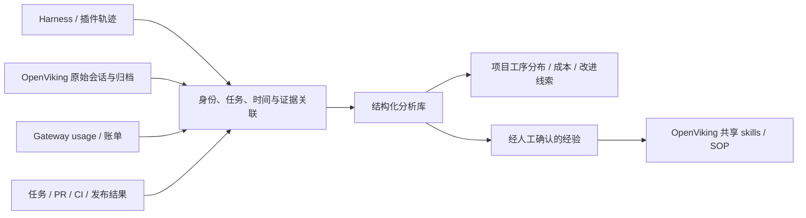

# 部门 AI Coding 可观测：采用、方法、交付与成本

分析日期：2026-10-22。本文为落地建议，不代表 OpenViking 已实现以下分析平台。仓库事实依据当前工作区源码，行业方法依据公开的一手研究与产品资料；建议指标、试点规模和分类口径均为本次设计。

## 1. 先回答业务问题

公司可以借助 OpenViking 判断 AI 参与了哪些项目、哪些工序，发现可复制的好方法，并结合模型用量优化成本。但仅靠提取后的长期记忆，无法可靠还原完整工作轨迹、员工工时或交付质量。

建议建设以任务为单位的 AI 工作观测：

- 采用情况：哪些人员、项目与任务使用了哪些 AI 能力。
- 使用方法：如何给上下文、拆任务、委派、验证、纠错和复用经验。
- 交付结果：产物是否通过验收，周期、缺陷和返工如何变化。
- 成本：完成一个验收通过的同类任务消耗多少模型费用及可测人力投入。

管理问题应落到“哪些做法在什么任务上有效、如何推广”，个人反馈落到具体任务证据，避免把 token、消息数或多 Agent 使用直接等同于能力。

## 2. 公开行业方法能借鉴什么

### 2.1 SPACE：开发者生产力不能由单一活动指标代表

SPACE 提供满意度与身心状态、绩效、活动、沟通协作、效率与心流等维度。它是研发度量框架，不是 AI 使用能力的现成评分表。可借鉴的是：结果、体验与协作需要同时观察，不能只统计活动次数。

来源：[Microsoft Research / SPACE，2021](https://www.microsoft.com/en-us/research/publication/the-space-of-developer-productivity-theres-more-to-it-than-you-think/)。

### 2.2 DORA：交付表现主要在团队和产品服务层面观察

DORA 强调跨职能团队共同负责交付，建议跟踪同一应用随时间的表现。个人 PR 合并慢，可能是评审队列、依赖和发布流程导致，不能直接归因于个人能力。交付周期与稳定性可作为团队改善结果，不宜机械拆成个人排名。

来源：[DORA：How to empower software delivery teams](https://dora.dev/guides/how-to-empower-software-delivery-teams/)。

### 2.3 GitHub Copilot：采用、活动与 PR 生命周期连接观察

公开产品指标包括采用情况、活动、代码生成和 PR 生命周期，并连接采用分组与 PR 产出。这说明行业产品也在把使用信号和交付信号结合起来。采用分组描述使用方式，不等于能力等级；观测到的关联不证明 AI 造成了改善。

来源：[GitHub Copilot usage metrics](https://docs.github.com/en/copilot/concepts/billing-and-usage/copilot-usage-metrics/copilot-metrics)。

### 2.4 METR：时间和效果测量本身需要校准

METR 2026-02-24 的实验更新指出，参与者自选择与多 Agent 并行使效果估计、逐任务时间测量变得困难。不能把早期特定样本中的结果直接推广为当前所有 AI Coding 的效果，也不能只凭“我感觉快了”估算收益。

来源：[METR：Changing our Developer Productivity Experiment Design](https://metr.org/blog/2026-02-24-uplift-update/)。

以上是公开可核实的方法与产品实践示例，并非所有企业的统一标准。以下四层方案是结合本部门目标提出的设计。

## 3. 四层指标与证据边界

| 层次 | 建议指标 | 主要数据来源 | 能说明什么 | 不能直接推断什么 |
|---|---|---|---|---|
| 采用情况 | 活跃使用者、覆盖任务、工具/模型分布、规范 skill 使用 | Harness、网关、OpenViking 轨迹 | 采集范围内的采用情况 | 没数据即没使用，使用多即能力强 |
| 使用方法 | 目标与验收是否明确、上下文是否准确、验证与纠错证据、经验复用 | 原始会话、工具轨迹、产物抽样 | 哪些行为值得推广或改进 | 某种提示模板必然提高产出 |
| 交付结果 | 验收通过、交付周期、评审返工、回滚与关联缺陷 | 任务、Git/PR、CI、发布和事故系统 | 实际产出与稳定性 | 全部变化都由 AI 或个人导致 |
| 成本 | 每个验收通过任务的模型费用、重试、缓存、可测人力投入 | usage、供应商账单、任务与人工记录 | 成本结构和优化方向 | token 数等同费用，AI 运行时间等同人工工时 |

四层分开报告，不用固定加权公式压成“AI 能力总分”。高采用、差结果意味着需要改进工作流；低采用可能是任务不适合、接入不足或数据缺失，需进一步核实。

## 4. 当前 OpenViking 已有的数据与缺口

### 4.1 原始消息与工具轨迹

`openviking/message/message.py:22` 的 Message 包含 id、role、parts、peer_id、created_at、turn_id、message_kind、source_message_ids，可支撑会话片段和来源追踪。

`openviking/message/part.py:43` 的 ToolPart 包含工具名、输入输出、状态、skill_uri，以及可选的 duration_ms、prompt_tokens、completion_tokens。字段存在不代表所有插件均已填充，需要先抽样检查实际数据。

这两类数据能帮助判断任务意图、查找过哪些知识、运行过哪些工具、是否出现测试或纠错。工具显示测试完成仍不等于产物已验收，必须关联真实测试结果和提交版本。

### 4.2 时间字段不能直接换算员工工时

`openviking/message/message.py:76`、`openviking/session/session.py:928` 会在缺少 created_at 时使用当前时间。该时间可能反映补写或入库时刻，并非原始操作发生时刻。

建议分别记录：

| 时间 | 定义 | 限制 |
|---|---|---|
| 任务历时 | 任务开始到验收的日历间隔 | 包含等待、会议、跨日与阻塞 |
| Agent 执行时间 | 有明确开始结束的工具/运行 span | 并行 span 不能简单当人工时间相加 |
| AI 交互活跃窗口 | 按明确规则合并的用户交互片段 | 只是代理指标，必须报告间隔阈值和敏感性 |
| 人工投入 | 任务相关主动投入的人工记录或抽样测量 | 不能仅靠会话时间自动得到 |

若没有人工投入数据，报告“AI 可观测活动分布”，不要命名为“员工工时分布”。把两条并发 Agent 各运行 20 分钟计为 40 分钟人工投入是错误的。

### 4.3 Gateway 有模型 usage，但并非完整财务账本

`openviking_gateway/proxy.py:347` 记录响应 usage 与 duration_ms。计时起点在 `proxy.py:192`，位于 route/prepare 之后，因此不是从客户端发起到完成的完整端到端时延。

`openviking_gateway/protocols.py:463` 将不同协议用量归一化，其中 input_tokens 已包含 cached_tokens 和 cache_write_tokens。费用计算必须按供应商口径拆分互斥计费桶，避免把整个 input_tokens 按原价收费后，再重复加缓存费用。缺失上报不应解释为真实零用量。

`openviking_gateway/tool_loop.py:95`、`:241` 涉及网关内部续轮及汇总。一个客户端请求可能对应多次上游模型请求；采集时应明确父请求、上游调用与汇总记录的关系，禁止把汇总与明细重复相加。

`openviking/metrics/datasources/model_usage.py:81` 另有服务端 VLM、embedding、rerank 用量来源。编码模型费用之外，记忆提取、嵌入、重排和分析自身也可能收费；现有聚合指标不能假定天然支持逐任务归因。

### 4.4 长期记忆适合找经验，原始轨迹适合分析过程

`openviking/server/mcp_endpoint.py:1360` 的 remember 提交消息并由后台提取决定创建或更新记忆；`openviking/session/session.py:1369` 的 commit_async 区分归档与后台提取。这种选择性加工不等于完整事件账本。

分析应保留原始 session/archive 和证据位置，不能只统计记忆条数、记忆类型或记忆文字。生产力事件建议进入独立分析库；OpenViking 提供语义检索、证据查询和经验沉淀。

### 4.5 插件与网关共存时的分工

`openviking_gateway/kernel.py:229` 检测插件后停用网关主动记忆；`:714` 对 disabled 的捕获提前返回。因此共存时可由网关提供模型用量、由插件写入的 OpenViking 会话提供任务语义，两路记录需要显式关联。

不能从“网关保存正常”推断插件端保存成功，也不能假设网关会话 ID、插件会话 ID、任务 ID 已自动统一。

## 5. 数据怎么连接

建议的数据单元是 task_segment：一个任务中连续承担一种主要工序的片段。一个 session 可对应多个任务或片段，一个任务也可跨多个 session、多个 PR。不要强制一对一。

以下是需要设计的关联字段，不是当前 OpenViking 已具备的统一协议：

- 身份：employee_id、OpenViking account/user、网关 credential_id、客户端身份；支持多人共享凭据的不可归因状态。
- 任务：task_id、project_id、repo_id、branch、PR/commit、session_id、turn/span、model_request_id。
- 分类：work_stage、判定方式、置信度、证据位置、unknown 原因、人工修正记录、规则/分类器版本。
- 用量：模型及计费版本、原始 usage、是否完整、重试、缓存、父子请求关系、归因方式。
- 结果：验收证据、测试对应 commit、评审结论、关联缺陷、结果观察截止时间。

没有稳定任务 ID 时先做可解释的候选关联，并报告关联覆盖率。跨任务共用的请求可单列 shared/unallocated，后续分摊需声明规则，不应制造精确归因。

## 6. 如何识别项目与工序

### 6.1 项目归属优先使用确定信号

优先级建议：明确任务编号/用户指定项目 → repo 与项目登记表 → PR/分支/路径 → 语义推断。共享仓库、公共组件和跨仓库项目需单独映射，不能认为 repo 就是项目。

语义分类必须保留置信度与证据；低置信度标 unknown 或待确认。无法可靠关联的内容不强行分配给某项目。

### 6.2 工序用片段级标签

| 工序 | 主要判断依据 | 需要注意 |
|---|---|---|
| 理解与调研 | 阅读代码、定位机制、需求澄清 | 大量 read/search 可能也在排障中发生 |
| 方案设计 | 权衡方案、接口/数据模型、风险与验收讨论 | 不以输出文件扩展名作唯一判断 |
| 实现与重构 | 源码修改、补丁、功能实现 | 生成代码不是验收成功 |
| 测试与验证 | 测试设计、运行、复现、结果分析 | 区分无关测试、失败测试和对应版本通过 |
| 评审与交付 | review、修复评审意见、合并与发布 | PR 等待时间不全是工作投入 |
| 线上故障处理 | 明确事故/告警关联、定位与恢复 | 排障内可能包含设计、实现、测试子阶段 |
| 文档与知识沉淀 | 整理规范、SOP、共享 skill 与复盘 | 数量不能替代准确性和复用效果 |

建议将“任务场景”和“工序”分成两个轴：场景可为新需求、缺陷修复、线上事故等；工序可为设计、实现、验证等。这样既能统计线上事故投入，也能知道事故处理中的验证占比，避免两个维度混成互斥标签。

## 7. 如何判断某位同学 AI 用得好不好

定义：在合适的任务上，能用可验证、可维护的方式交付结果，并合理控制人力与模型成本。具体判断需要与同类任务难度、环境和结果证据结合。

### 7.1 用任务证据评价方法

| 维度 | 正向证据 | 值得改进的证据 | 验证方式 |
|---|---|---|---|
| 问题定义 | 目标、约束、验收清楚 | 目标漂移，反复重做 | 需求、初始任务与最终验收对应 |
| 上下文使用 | 提供相关代码与规范，发现错误上下文及时纠正 | 错仓库、陈旧信息、无关大段灌入 | 检索/读取记录与实际变更比对 |
| 委派判断 | 任务边界清晰，工具/模型与难度匹配 | 任务互相覆盖，简单任务循环调用 | 任务拆分与调用轨迹抽样 |
| 验证与责任 | 检查 diff、运行相关验证、处理失败 | 只接受模型自述，没有验收证据 | commit、CI、评审与验收 |
| 纠错效率 | 根据错误证据改变策略 | 同一失败原样重复，越修越偏 | 失败到修复的具体过程 |
| 复用与协作 | 经验证的方法形成规范/SOP并被他人有效复用 | 记录大量但不可用，重复踩坑 | 使用样例、后续任务结果与维护记录 |

自动分类先给出“观察线索”，由本人或同行结合证据确认。没有记录不能直接判成“未做”；工具未接入、采样不足和线下操作均可能缺失。若需要等级，逐维记录“证据充分/部分充分/需改进/证据不足”，不把证据不足记为零分。

### 7.2 比较同类任务，同时观察自己的变化

优先同一个人前后比较，再比较相似任务群体。匹配维度包括场景、模块熟悉度、复杂度、代码库状态、模型与权限、验收要求、外部依赖。无法匹配时报告差异，不声称精确公平排序。

例如 A 用 80 万 token 完成一个经过验收的复杂改造，B 用 10 万 token 完成一个小缺陷，不能认定 B 更会用 AI。即便任务相近，也需要合并后观察质量和返工；评审次数多可能表示严格评审，并非产物更差。

### 7.3 分开回答三个问题

1. 个人方法是否成熟：基于任务证据给具体反馈。
2. 团队结果是否改善：跟踪可比任务的周期、质量、协作负担。
3. 改善是否由 AI 导致：需要基线和更严格的实验设计，不能由前后变化或分组相关性直接推出。

若要估计因果收益，可对重复、可比且有独立验收的任务随机分配工作流；要控制学习效应与任务差异，不让同一个人第二次重复同一题的熟练优势冒充 AI 效果。真实生产试点无法随机时，应将结论限定为观察关联。

## 8. 成本怎么优化才有意义

### 8.1 先算对成本

建议同时显示总费用和“每个验收通过任务的费用”。分母只计通过任务，分子保留观察范围内失败、放弃和返工的费用，避免把失败成本移出报表制造漂亮结果。跨期任务使用任务批次或明确观察截止时间。

模型费用包括编码模型调用、网关内部续轮、记忆提取与其他服务端模型调用、分类分析。用量先按供应商与价格版本计费，再与账单核对；订阅额度或固定成本的分摊与按次费用分开说明。

人工成本只能使用有依据的投入记录；没有记录时分开列出模型费用、交付历时、人工抽样，不能宣称已经算出完整 ROI。

### 8.2 优先寻找可验证的浪费

| 改进方向 | 可观察线索 | 验证收益时要同时看 |
|---|---|---|
| 缩减无关上下文 | 长工具输出、重复读同一材料 | 正确率与后续补查是否变差 |
| 提升缓存稳定性 | 相同任务前缀频繁变化、缓存命中变化 | 实际供应商费用与延迟 |
| 复用规范/SOP | 同类背景反复解释、相同排障重复摸索 | 命中相关性、维护成本和返工 |
| 模型分工 | 简单任务长期使用高成本模型 | 验收质量及升级重试成本 |
| 修复失败循环 | 同类工具错误、环境失败反复重试 | 总调用下降且完成率不下降 |
| 改善任务边界 | 多 Agent 重复探索、互相覆盖修改 | 协调与集成成本、总体交付周期 |

记忆并非天然省钱：检索、注入、提取与索引都会增加开销。只有减少的重复探索和返工超过这些增量成本，且质量不下降时，才构成净收益。缓存命中高也不必然意味着总费用低。

## 9. 建议的最小试点

以下是起步规模建议，不是行业标准：5–10 位自愿参与工程师，选 2–3 类重复出现的任务，先运行 2–4 周；若完成任务数不足或质量观察窗口不够，延长观察，不强做结论。

1. 数据盘点：核对消息/工具实际字段、插件捕获覆盖、模型 usage 完整性、身份与任务关联能力。先报告缺失率。
2. 标签校准：抽取约 30–50 个任务片段，由人工确认项目、场景与工序；检查不同人员是否理解一致，保留 unknown。
3. 建立事实底表：原始事件保留来源；确定规则优先，语义分类按任务片段增量执行，分类器版本可追溯，不逐条事件调用大模型。
4. 连接结果：至少关联任务验收、PR/commit 与相关 CI。事故处理另加恢复与后续复发结果。
5. 每周复盘：让本人修正误归因，挑选少量成功与失败任务，确认成本高的原因。
6. 小范围验证：一次优化一项，例如精简工具输出或引入一个 SOP，比较同类任务的费用、验收率、周期和返工。

首版输出四类结果：项目×工序的可观测活动分布；费用及失败循环分解；任务交付结果；可复用的优秀案例和待改进案例。个人页面展示证据与改进建议，团队页面展示聚合趋势，不制作缺乏证据的总能力排行榜。

试点开始前约定成功条件：身份/任务关联与标签质量达到团队认可的覆盖；账单误差可解释；至少验证一项有质量约束的改善。可将关联覆盖率 80%、抽样标签一致率 85% 作为待协商的起点，而非已证明适用的验收线；应同时报告样本量和未知比例。

## 10. 验证范围

本次为源码核查和公开资料研究，没有新增遥测、导出员工会话、调用付费模型或完成效果实验。人员 ID 联合、任务切分、结果关联、分类器、成本分摊和反馈看板均属于待实现设计。

此前图谱已确认缺少模型网关核心节点；本次执行 `graphify explain 'openviking/message/message.py::Message' --budget 450` 作为关系辅助查询。图谱中的旧节点与行号不替代当前源码；未建立或重建 CodeGraph/Graphify 索引。
